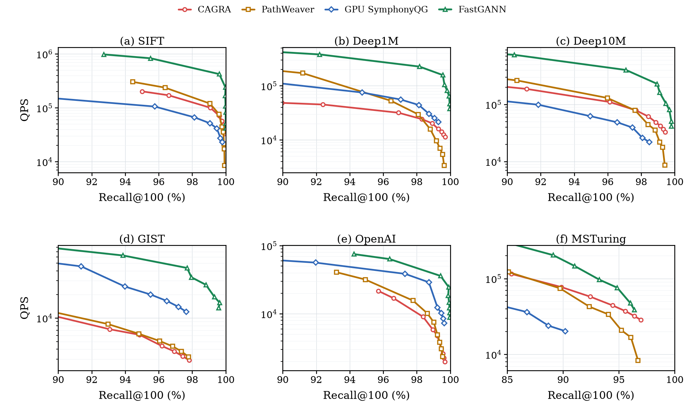

# fastGANN

fastGANN is an accuracy- and hardware-aware graph-based approximate nearest neighbor search (ANNS) system designed for efficient search on GPUs. The project builds on our [prior work](https://openreview.net/forum?id=FiMBPm5JxL) published at the VecDB 2026 workshop.

🚧 This project is under active development. The current branch includes ParlayANN, SymphonyQG (our CPU port with multithreading support), CAGRA, and Jasper baselines, benchmarking scripts, and dataset preparation tools.



*Figure 8 of the VecDB 2026 workshop paper: Recall@100 vs. QPS of CAGRA, PathWeaver, GPU SymphonyQG (our GPU port of SymphonyQG), and fastGANN on SIFT, Deep1M, Deep10M, GIST, OpenAI, and MSTuring. fastGANN is able to achieve consistent speedup over existing baselines.*

## Baselines

Baselines include pinned upstream submodules and our parallel CPU port of SymphonyQG, with benchmark programs for the paper's configurations.

| baseline | source | pinned commit | bench |
|---|---|---|---|
| ParlayANN (CPU) | `benchmark/parlayann/ParlayANN` (cmuparlay/ParlayANN) | a48c6a3 | `benchmark/parlayann/bench_parlayann.cc`: ParlayANN's `qsearchAll` on a fixed-degree graph |
| SymphonyQG parallel (CPU) | `benchmark/symphonyqg-parallel` (local port) | — | `benchmark/symphonyqg-parallel/symqg_parallel.cpp`: L2 FastScan codebook search with OpenMP query parallelism |
| CAGRA (GPU) | `benchmark/cagra/cuvs` (rapidsai/cuvs) | 0c3d007 (26.08 dev, 2026-06-02) | `benchmark/cagra/bench_cagra.cu`: cuVS CAGRA on an external graph |
| Jasper (GPU) | `benchmark/jasper/jasper` (saltsystemslab/jasper) | a0173f4 | Jasper's own `run_query` |

### Build

```bash
git submodule update --init --recursive
bash benchmark/build_all.sh
```

Defaults: `g++-12`, CUDA 13.1, and the `cuvs` Conda environment. Override with `CXX`, `CUDA_HOME`, or `CUVS_ENV`.
An optional argument selects CAGRA's CUDA architecture, e.g. `bash benchmark/build_all.sh 90` (default 89).

cuVS fetches rapids-cmake, raft and rmm from their `main` branches, which no longer build with 0c3d007.
`build_cuvs.sh` pins them to the commits of the paper's build: rapids-cmake 1e88d0d, raft 0903417, rmm 4d354f6.

## Dataset Preparation

`preprocessing/prepare_msturing1m.sh` downloads big-ann-benchmarks' MS Turing 1M subset (about 520 MB) into
`dataset/msturing1m/` and writes:

| file | contents |
|---|---|
| `msturing1m_{base,query}.fvecs`, `msturing1m_groundtruth.ivecs` | 1M base, 100K queries, top-100 ids |
| `symqg32.index` | upstream SymphonyQG index, degree 32, EF 400, 3 iterations, FastScan codebook |
| `symqg32.graph.bin` | that index's graph (`uint32 n, degree`, then the neighbor ids), read by ParlayANN, CAGRA and Jasper |
| `symqg32.jasper` | the same graph and entry point in Jasper's native format |
| `query100K.fbin`, `msturing-gt-1M` | downloaded query and ground-truth binaries, used directly by Jasper |

Requires Python 3.11 or newer, a C++17 compiler with OpenMP support, and a CPU with AVX-512 for SymphonyQG. From the repository root:

```bash
python3 -m venv .venv
source .venv/bin/activate
pip install -r preprocessing/requirements.txt -r benchmark/requirements.txt
pip install --no-build-isolation --no-deps preprocessing/SymphonyQG/python
bash preprocessing/prepare_msturing1m.sh
```

SymphonyQG's `setup.py` pins `numpy==1.26.4`. For this environment, `--no-deps` skips that dependency pin,
while `--no-build-isolation` builds against the NumPy and pybind11 versions installed above. The upstream package
metadata retains the old NumPy requirement, so `pip check` reports this known version conflict.

## Figure 1 (MS Turing 1M)

After building the baselines and preparing the dataset:

```bash
bash benchmark/run.sh
bash benchmark/plotting.sh
```

`run.sh` runs all four methods at one fixed beam each; `plotting.sh` collects the logs and plots median QPS over three trials.
Outputs `fig01.pdf`, `fig01.png`, and `plot_data.csv` under `result/fig01_msturing1m/`.

Optional settings: `TRIALS`, `THREADS` (default 16), `CUDA_VISIBLE_DEVICES` (default 0), and `RESULT_DIR`.

## Publications

Please cite the following paper if you use this code:

```
@inproceedings{
sun2026fastgann,
title={Fast{GANN}: Marrying Quantization with Pruning for {GPU} {ANNS}},
author={ZeAi Sun and jinxu Liu},
booktitle={The 2nd Workshop on Vector Databases},
year={2026},
url={https://openreview.net/forum?id=FiMBPm5JxL}
}
```
